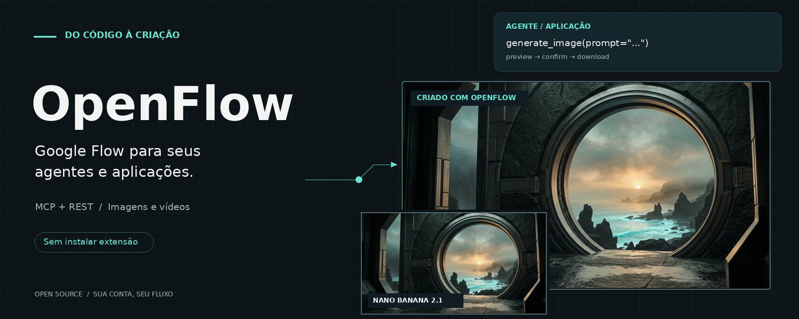

<div align="center">
  
  <h1>OpenFlow · Sua assinatura Google AI Pro no fluxo dos seus agentes</h1>
  <p><strong>Transforme sua assinatura Google AI Pro em um fluxo de criação de imagens e vídeos com IA.</strong></p>
  <p>Conecte o Google Flow aos seus agentes e aplicações via MCP ou REST. Envie prompts, acompanhe gerações e baixe os resultados sem ficar alternando entre ferramentas.</p>
  <p>Use os modelos e créditos disponíveis na sua conta para criar banners, assets e cenas para seus projetos, com prévia e confirmação antes de gerar.</p>

[](LICENSE)
[](https://github.com/codexfast/openflow/stargazers)
[](https://github.com/codexfast/openflow/forks)
[](https://github.com/codexfast/openflow/issues)
[](https://github.com/codexfast/openflow/commits/main)
[](pyproject.toml)
[](extension/manifest.json)
[](#mcp)
[](#rest)

[🚀 Início rápido](#quick-start) · [💡 Recursos](#features) · [🔌 Integrações](#clients) · [📖 Instalação](#setup) · [🧪 Verificações](docs/matrix-verified.md) · [❓ FAQ](#faq) · [🐛 Suporte](https://github.com/codexfast/openflow/issues)

</div>

<p><sub><strong>Aviso de uso:</strong> OpenFlow é uma integração independente e não oficial, sem afiliação ou endosso do Google. Use por sua conta e risco. A automação pode contrariar termos ou políticas do serviço e pode resultar em restrições, suspensão ou banimento da conta; o projeto não garante proteção contra essas medidas. Gerações podem consumir créditos e continuam sujeitas ao plano, aos limites e à disponibilidade do Flow. Consulte os termos aplicáveis antes de usar.</sub></p>

## 🤔 Por que OpenFlow?

Você já paga pela assinatura. Leve os recursos do Flow para onde seus projetos acontecem.

Com o OpenFlow, seu agente pode preparar uma imagem para o README, solicitar cenas para um vídeo ou baixar assets para uma aplicação. Você aprova a prévia e a geração acontece na sua sessão do Flow, usando os recursos disponíveis na sua conta.

| Sem a ponte | Com OpenFlow |
| --- | --- |
| Alternar entre agente e navegador para enviar prompts | Solicitar geração pelo cliente MCP ou pela API REST |
| Acompanhar cada resultado manualmente | Consultar jobs e baixar os resultados disponíveis |
| Criar integração própria para cada aplicação | Usar uma camada compartilhada de operações |
| Reenviar após timeout sem saber se houve cobrança | Identificar submissão incerta e impedir reenvio automático |

**Seu navegador, sua conta, seu projeto.** O OpenFlow não fornece modelos próprios nem substitui o plano do Flow.

<a id="features"></a>
## 💡 Recursos

| Área | Suporte documentado |
| --- | --- |
| 🍌 Imagens | Nano Banana Pro, Nano Banana 2 e Nano Banana Lite |
| 📐 Proporções | `1:1`, `9:16`, `16:9`, `3:4`, `4:3` |
| 🎬 Vídeos Omni | Texto, quadro inicial, inicial/final e referências; 4–10 segundos |
| 🎞️ Veo Lite | Quadro inicial, 8 segundos, 720p |
| 🔍 Upscale | Imagem 2K e vídeo 1080p nos cenários registrados |
| 📁 Projetos e mídia | Criação de projeto, upload, consulta de jobs e download |
| 🔌 Integrações | MCP stdio/HTTP e API REST com OpenAPI |
| 🛡️ Controle | Pareamento, contexto fixado em aba/documento, prévia e confirmação |
| 💾 Persistência | SQLite; identificação de resultados não verificados |

**Verificação recente:** em 10/10/2026, Nano Banana 2.1 foi gerado e baixado via MCP. O nome público `nano_banana_2` agora mapeia para `BELUGA`. Vídeos e upscales têm registros históricos na [matriz](docs/matrix-verified.md), não uma garantia de funcionamento atual em todas as contas.

## 🔄 Como funciona

```text
       Agente MCP                    Aplicação REST
           │                               │
           ▼                               ▼
      Servidor MCP                    API FastAPI
           └──────────────┬────────────────┘
                          ▼
               Operações + jobs SQLite
                          │
               WebSocket 127.0.0.1:9233
                          │
                          ▼
                   Extensão Chrome
                          │
                          ▼
                Aba autenticada do Flow
                Sua conta · Seus créditos
```

MCP e REST são entradas alternativas. Na configuração padrão, execute **um por vez**, pois ambos usam a ponte na porta `9233`. O servidor deve estar na máquina do navegador; o cliente pode estar em outra máquina com acesso seguro.

<a id="quick-start"></a>
## 🚀 Início rápido

### 1. Clone e instale

```bash
git clone https://github.com/codexfast/openflow.git
cd openflow
uv sync
```

Requer Python 3.11+, `uv`, Chrome 116+ e uma conta com acesso ao Flow.

### 2. Carregue a extensão

1. Abra `chrome://extensions` e ative **Modo do desenvolvedor**.
2. Clique em **Carregar sem compactação** e selecione `extension/`.
3. Abra [Google Flow](https://flow.google.com/) e faça login no próprio navegador.
4. Abra o projeto em que deseja gerar mídia e mantenha a aba disponível.
5. Configure o cliente MCP abaixo ou inicie a API REST.
6. Habilite a conexão no popup e confira o código antes de autorizar o pareamento.

### 3. Conecte seu agente — exemplo OpenCode

```json
{
  "mcp": {
    "openflow": {
      "type": "local",
      "command": ["uv", "--project", "/caminho/absoluto/openflow", "run", "openflow"],
      "enabled": true
    }
  }
}
```

Substitua o caminho. Esse formato é do **OpenCode**, não uma configuração universal para todos os clientes.

**Prefere REST?** Na máquina do navegador:

```bash
uv run openflow-api --host 127.0.0.1 --api-port 8100
```

Abra `http://127.0.0.1:8100/docs` para explorar os schemas reais da API.

### 4. Faça sua primeira geração

```text
list_connections → conferir código → approve_connection
    → get_connection / select_flow_tab
    → generate_image (confirm=false)
    → conferir prévia → confirmar com o mesmo preview_id
    → get_job → download
```

Exemplo de pedido ao agente:

> Use o OpenFlow no projeto selecionado. Prepare uma imagem de uma capivara
> à beira de um lago ao pôr do sol, com Nano Banana 2, em 16:9. Mostre a
> prévia e aguarde minha aprovação antes de gerar. Depois baixe o resultado.

<a id="clients"></a>
## 🔌 Clientes e aplicações

O OpenFlow fala MCP, não uma API de chat compatível com OpenAI. Use um cliente que aceite servidores MCP e ferramentas.

| Cliente / aplicação | Caminho de integração | Estado |
| --- | --- | --- |
| Hermes Agent | Servidor MCP HTTP | Geração e download de imagem verificados nesta instalação |
| OpenCode | Configuração MCP local acima | Exemplo documentado; verifique sua versão |
| Claude Code, Codex, Cursor, Cline e outros | Cadastrar o comando stdio no gerenciador MCP do cliente | Compatibilidade depende do cliente; não testados individualmente aqui |
| Aplicação própria / scripts | API REST + OpenAPI | Contratos disponíveis em `/docs` |

Comando genérico stdio:

```bash
uv --project /caminho/absoluto/openflow run openflow
```

Não configure o OpenFlow como provedor de LLM. Cada cliente tem seu próprio formato de configuração MCP.

## 🎯 Casos de uso

- **Assets para repositórios:** gerar fundos para banners, ilustrar documentação e baixar arquivos para o projeto.
- **Pipeline de conteúdo:** solicitar imagens e clipes, acompanhar jobs e entregar a mídia para um editor ou montador externo.
- **Prototipagem visual:** preparar variações de imagens a partir de prompts e referências pertencentes ao contexto selecionado.
- **Aplicações locais:** integrar Flow a ferramentas internas usando REST, com confirmação e controle de execução.

O OpenFlow entrega operações de mídia; não inclui edição de vídeo, publicação em redes sociais ou um dashboard web próprio.

## 💰 Código aberto, créditos da sua conta

| Item | Como funciona |
| --- | --- |
| Código OpenFlow | MIT; sem tarifa própria de geração |
| Google Flow | Acesso, modelos, limites e créditos dependem da conta e do plano |
| Prévia | Prepara os dados, não executa a geração |
| Confirmação | Pode consumir créditos; confira o Flow antes de aprovar |
| Submissão incerta | Não reenvie automaticamente; a operação pode ter sido aceita |

Estimativas históricas estão na [matriz verificada](docs/matrix-verified.md). A interface do Flow é a referência para custos atuais. Não há promessa de geração ilimitada ou gratuita.

<a id="faq"></a>
## ❓ Perguntas frequentes

<details>
<summary><strong>É uma API oficial do Google Flow?</strong></summary>

Não. É uma ponte independente que usa a sessão autenticada do navegador e interfaces internas do serviço. Não há afiliação com o Google nem garantia de estabilidade dessas interfaces.

</details>

<details>
<summary><strong>Preciso fornecer senha ou cookies ao agente?</strong></summary>

Faça login diretamente no navegador. A extensão opera no contexto dessa sessão; não compartilhe senhas, cookies ou tokens em prompts, issues ou logs.

</details>

<details>
<summary><strong>Por que a ferramenta ainda se chama nano_banana_2?</strong></summary>

Esse é o nome público do schema. O mapeamento atual usa o identificador `BELUGA` observado na interface Nano Banana 2.1. Mudanças futuras podem exigir outra atualização.

</details>

<details>
<summary><strong>Funciona em Docker ou em um servidor remoto?</strong></summary>

Esta instalação foi validada com Chromium persistente e servidor em Docker. O repositório ainda não distribui uma imagem pronta nem um Compose oficial. É necessário um navegador operacional, login e acesso seguro; não exponha MCP, REST ou CDP publicamente.

</details>

<details>
<summary><strong>Posso executar MCP e REST ao mesmo tempo?</strong></summary>

Não com as portas padrão: ambos iniciam a ponte `9233`. Escolha uma entrada por vez. Mudar só a porta do servidor não reconfigura a extensão.

</details>

<details>
<summary><strong>Um timeout significa que a geração falhou?</strong></summary>

Não. `submitted_unverified` significa resultado incerto. Consulte o job e o projeto antes de reenviar; a geração pode ter ocorrido e consumido créditos.

</details>

<details>
<summary><strong>O banner do README foi feito com o próprio OpenFlow?</strong></summary>

Sim. O fundo foi gerado no Nano Banana 2.1 via MCP, baixado e recebeu tipografia na montagem local. `assets/banner-social.png` é uma versão 1280×640 para configurar manualmente o social preview no GitHub.

</details>

## 📚 Guia completo

- [Requisitos](#requisitos) · [Instalação](#setup)
- [MCP](#mcp) · [REST e exemplos](#rest)
- [Segurança e créditos](#segurança-e-créditos)
- [Compatibilidade e limitações](#compatibilidade-e-limitações)
- [Desenvolvimento](#desenvolvimento) · [Solução de problemas](#solução-de-problemas)
- [Contribuições](#contribuições) · [Créditos e licença](#créditos-e-licença)

---

## Requisitos

- Python **3.11 ou superior**.
- `uv` para gerenciamento do ambiente, ou Python com `pip` em um ambiente virtual.
- Google Chrome **116 ou superior**.
- Conta com acesso ao Google Flow e créditos quando exigidos pela operação.
- Um cliente compatível com MCP, caso escolha essa integração.
- Node.js com suporte a `node --test` para executar os testes da extensão.

<a id="setup"></a>
## Instalação

### 1. Preparar o ambiente

Na raiz do projeto:

```bash
uv sync --extra dev
```

Para instalar apenas as dependências de execução:

```bash
uv sync
```

Alternativamente, em um ambiente virtual já ativado:

```bash
python -m pip install -e ".[dev]"
```

### 2. Carregar a extensão

1. Abra `chrome://extensions` no Chrome.
2. Ative o **Modo do desenvolvedor**.
3. Escolha **Carregar sem compactação** e selecione a pasta `extension/`.
4. Abra [Google Flow](https://flow.google.com/) com sua conta autenticada e mantenha a aba aberta.
5. Configure e inicie uma das integrações abaixo.
6. No popup da extensão, habilite a conexão.
7. Compare o código de pareamento exibido na extensão antes de aprovar a conexão pelo cliente.

Após atualizar arquivos de uma extensão sem compactação, use **Recarregar** em `chrome://extensions` e depois recarregue a aba do Flow. Alterar o arquivo no disco não prova que o service worker carregou o código novo.

<a id="mcp"></a>
## Integração MCP

### Cliente local

Para um cliente como o OpenCode, adicione a configuração abaixo ao arquivo de configuração do cliente. Substitua o caminho absoluto pelo diretório deste projeto:

```json
{
  "mcp": {
    "openflow": {
      "type": "local",
      "command": [
        "uv",
        "--project",
        "/caminho/absoluto/openflow",
        "run",
        "openflow"
      ],
      "enabled": true
    }
  }
}
```

No Windows, use um caminho como `C:\\Projects\\openflow`. O cliente inicia o servidor em modo stdio; não é necessário abrir outro processo MCP manualmente.

Com `pip`, configure o cliente para executar o Python do ambiente virtual com os argumentos `-m flow_mcp.server`.

### Fluxo de uso

1. Consulte `list_connections` e `list_pairing_requests`.
2. Execute `approve_connection` somente após o usuário conferir o código da extensão.
3. Use `get_connection` e `select_flow_tab` para selecionar a aba e seu documento.
4. Solicite a operação, como `generate_image`, `generate_video` ou `upload`, com `confirm=false`.
5. Apresente a prévia ao usuário e aguarde aprovação.
6. Repita a operação com os mesmos dados, `confirm=true` e o `preview_id` retornado.
7. Consulte `get_job` com `refresh=true` e use `download` quando o resultado estiver disponível.

**Não reenvie automaticamente um job em `submitted_unverified`.** A submissão pode ter ocorrido mesmo sem confirmação de resposta, e uma nova tentativa pode gerar cobrança duplicada.

### Cliente em outra máquina

> O transporte HTTP está implementado, mas foi necessário um wrapper de lifespan nesta instalação para iniciar a ponte no nível da aplicação. Esse wrapper local ainda não está incluído neste repositório. Se o HTTP responder mas a extensão não conectar, use stdio ou REST e reporte o problema com a versão da dependência `mcp`. Não considere a conexão HTTP, isoladamente, prova de que a ponte está ativa.

Na máquina do Chrome:

```bash
uv run openflow --transport streamable-http --host 0.0.0.0 --mcp-port 8000
```

No cliente MCP:

```json
{
  "mcp": {
    "openflow": {
      "type": "remote",
      "url": "http://<ip-da-maquina-do-chrome>:8000/mcp",
      "enabled": true
    }
  }
}
```

`0.0.0.0` expõe o serviço nas interfaces de rede da máquina. Restrinja o acesso no firewall a clientes confiáveis e use uma camada de autenticação e transporte seguro quando necessário. Não publique essa porta diretamente na internet.

<a id="rest"></a>
## API REST

Como alternativa ao MCP, inicie a API na máquina do Chrome:

```bash
uv run openflow-api --host 127.0.0.1 --api-port 8100
```

Documentação local enquanto o servidor estiver em execução:

- Swagger UI: `http://127.0.0.1:8100/docs`
- ReDoc: `http://127.0.0.1:8100/redoc`
- OpenAPI: `http://127.0.0.1:8100/openapi.json`

### Principais endpoints

| Método | Rota | Finalidade |
| --- | --- | --- |
| `GET` | `/health` | Estado do serviço |
| `GET` | `/connections` | Conexões e pareamentos pendentes |
| `GET` | `/pairings` | Solicitações de pareamento |
| `POST` | `/pairings/{pairing_id}/approve` | Aprovar pareamento conferido pelo usuário |
| `GET` | `/connections/{connection_id}` | Consultar conexão e abas |
| `POST` | `/connections/{connection_id}/select` | Selecionar aba com `tab_id` |
| `GET` | `/connections/{connection_id}/account` | Consultar conta |
| `POST` | `/projects` | Preparar ou confirmar criação de projeto |
| `POST` | `/images` | Preparar ou confirmar geração de imagem |
| `POST` | `/videos` | Preparar ou confirmar geração de vídeo |
| `POST` | `/images/upscale` | Preparar ou confirmar upscale de imagem |
| `POST` | `/videos/upscale` | Preparar ou confirmar upscale de vídeo |
| `POST` | `/uploads` | Preparar ou confirmar upload |
| `GET` | `/jobs/{job_id}` | Consultar ou atualizar job |
| `POST` | `/jobs/{job_id}/download` | Salvar resultado na máquina do servidor |

### Exemplo: prévia de imagem

Após aprovar o pareamento e selecionar a aba, envie `POST /images` com os identificadores reais da conexão e do projeto:

```json
{
  "connection_id": "<connection_id>",
  "project_id": "<project_id>",
  "input": {
    "prompt": "Um cubo vermelho sobre uma mesa de madeira, luz natural",
    "model": "nano_banana_2",
    "ratio": "1:1",
    "references": []
  },
  "confirm": false
}
```

Depois de conferir a prévia e obter aprovação humana, reenvie o mesmo corpo com `confirm` definido como `true` e o campo `preview_id` preenchido com o identificador da prévia retornada. Não altere os dados da operação entre prévia e confirmação.

Para atualizar o job, use `GET /jobs/{job_id}` com os parâmetros de consulta `connection_id`, `project_id` e `refresh=true`. Os schemas completos estão na documentação OpenAPI local.

## Segurança e créditos

- Mantenha MCP e REST locais sempre que possível. O pareamento da extensão não substitui autenticação de acesso ao servidor HTTP.
- A API REST atual não implementa autenticação HTTP própria e pode ler arquivos locais para upload e gravar downloads. Trate o acesso a ela como acesso privilegiado à máquina.
- Confira a conta, a aba selecionada e a prévia antes de confirmar operações.
- Uma prévia não representa autorização para executar. Clientes e agentes devem solicitar aprovação humana antes da confirmação.
- Consulte os custos e a disponibilidade na interface do Flow; estimativas documentadas podem ficar desatualizadas.
- Não compartilhe cookies, tokens, segredos de pareamento, bancos de jobs ou dados privados em issues e logs.
- Respeite os termos do Google Flow e os direitos sobre conteúdos enviados e gerados. A licença do código não concede direitos sobre serviços ou resultados de terceiros.

## Compatibilidade e limitações

O projeto utiliza chamadas internas do Flow no contexto do navegador, não uma API pública estável de geração. Mudanças no serviço, no reCAPTCHA, nos modelos ou nos planos podem interromper operações.

- Os cenários registrados na matriz foram verificados em **4 e 5 de outubro de 2026**; não são testes contínuos de disponibilidade.
- `veo_lite_low_priority` e `veo_fast_ultra` estão documentados como não implementados.
- Upscale de imagem em 4K não está validado como bem-sucedido na conta usada nos registros.
- A extensão está configurada para a ponte local na porta `9233`. Alterar apenas a porta do servidor não reconfigura a extensão.
- Jobs interrompidos podem exigir verificação manual antes de qualquer nova submissão.

## Desenvolvimento

### Estrutura

```text
openflow/
├── src/flow_mcp/       Servidores, ponte, operações e persistência
│   ├── server.py      Entrada MCP
│   ├── api.py         Entrada REST
│   ├── service.py     Operações compartilhadas
│   ├── bridge.py      Ponte WebSocket
│   ├── manager.py     Conexões e seleção de contexto
│   ├── pairing.py     Pareamento da extensão
│   └── jobs.py        Persistência dos jobs
├── extension/         Extensão Chrome Manifest V3
│   └── tests/         Testes JavaScript
├── tests/             Testes Python
├── docs/              Verificações e diagnósticos técnicos
├── pyproject.toml     Dependências e ferramentas de qualidade
└── LICENSE            Licença MIT original
```

### Verificações locais

Instale as dependências com `uv sync --extra dev` e execute, na raiz:

```bash
uv run pytest
uv run ruff check .
uv run mypy
node --test extension/tests/*.test.mjs
```

A suíte cobre contratos, pareamento, operações, persistência e integração com componentes simulados. Ela não substitui verificações reais na conta do Flow, que podem consumir créditos e devem ser executadas apenas com autorização.

## Solução de problemas

| Sintoma | O que verificar |
| --- | --- |
| Extensão não conecta | Servidor ativo, conexão habilitada no popup e porta `9233` disponível |
| Porta já em uso | Outro processo MCP ou REST pode estar executando a mesma ponte |
| Pareamento pendente | Compare o código da extensão antes de aprovar a solicitação |
| Aba não disponível | Abra o Flow autenticado, consulte a conexão e selecione a aba novamente |
| Falha após atualizar a extensão | Recarregue a aba do Flow para executar os scripts da versão atual |
| `submitted_unverified` | Verifique o job e o Flow antes de qualquer reenvio |
| `rpc_rejected` | Confira modelo, entradas, plano e restrições na matriz de verificações |
| `native_recaptcha_automation_unsupported` | A integração de reCAPTCHA esperada não está disponível; recarregue a aba e verifique a compatibilidade |

## Contribuições

Contribuições de código, testes e documentação são bem-vindas.

1. Descreva o problema ou a mudança proposta, incluindo passos de reprodução quando aplicável.
2. Mantenha as alterações focadas e siga os padrões existentes em Python e JavaScript.
3. Adicione ou ajuste testes quando mudar comportamento.
4. Execute as verificações locais antes de enviar uma contribuição.
5. Informe quais verificações foram realizadas e se houve testes reais no Flow.

Ao relatar problemas, inclua versões do Python, Chrome e extensão, além de mensagens de erro sanitizadas. Não inclua credenciais, dados de conta ou arquivos de mídia privados.

## Créditos e licença

Este projeto deriva do código de **tuannguyenhoangit-droid**. A autoria original é reconhecida e o aviso de copyright foi mantido sem alterações:

```text
Copyright (c) 2026 tuannguyenhoangit-droid
```

Distribuído sob a [licença MIT](LICENSE), que permite uso, cópia, modificação, distribuição e uso comercial, inclusive venda, desde que sejam preservados os avisos exigidos pela licença. O software é fornecido sem garantias, conforme o texto integral da licença.

Google, Google Flow e os nomes dos modelos pertencem aos respectivos titulares. Sua menção descreve compatibilidade e não implica afiliação.


## 🛠️ Stack

Python · MCP SDK · FastAPI · Uvicorn · WebSockets · Pydantic · httpx · SQLite · Chrome Manifest V3 · JavaScript ES Modules.

## 📧 Suporte

- [Relatar bug](https://github.com/codexfast/openflow/issues/new): inclua versões, passos de reprodução e erros sanitizados.
- [Propor melhoria](https://github.com/codexfast/openflow/issues): descreva o caso de uso antes de implementar mudanças grandes.
- [Enviar contribuição](https://github.com/codexfast/openflow/pulls): alterações focadas, testes e registro do que foi validado.

Não publique dados de conta, tokens, URLs assinadas de mídia ou bancos de jobs.

## 👥 Contribuidores

Veja os [contribuidores do repositório](https://github.com/codexfast/openflow/graphs/contributors). O crédito do código original permanece na licença e na seção acima.

## ⭐ Acompanhe o projeto

Se o OpenFlow ajudou seu fluxo de criação, uma estrela facilita encontrar o projeto novamente. [Stars](https://github.com/codexfast/openflow/stargazers) · [Forks](https://github.com/codexfast/openflow/forks) · [Histórico](https://github.com/codexfast/openflow/commits/main).

A organização visual deste README foi inspirada no [9Router](https://github.com/decolua/9router); recursos, exemplos e informações são específicos do OpenFlow.
